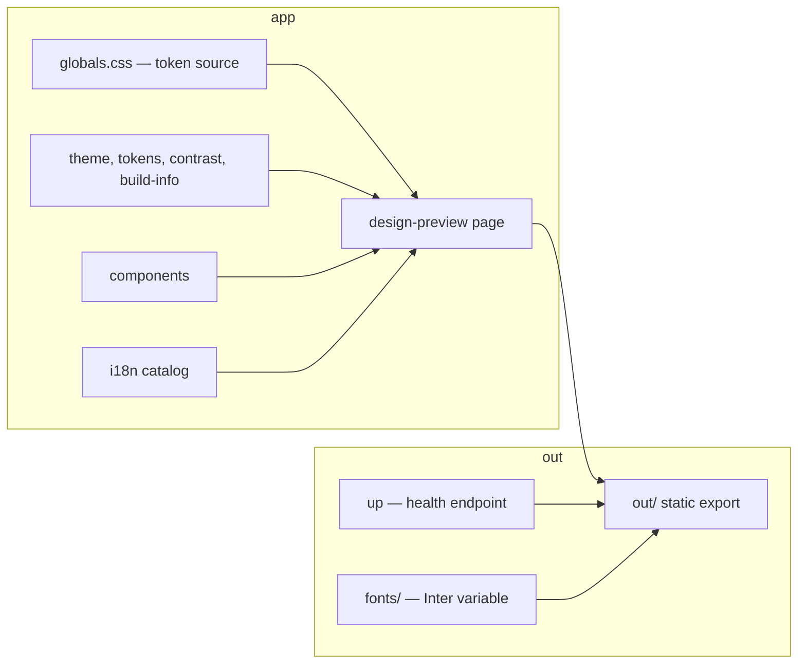

# memorynote.io

The design system of memorynote.io: one page, `/design-preview`, that
shows the color tokens, the type scale, the spacing and corner radii,
the breakpoints, and the four core components.

## Stack

- Next.js (App Router, static export) with React and TypeScript
- CSS custom properties in `src/app/globals.css` as the single token
  source
- `nginx:1.27-alpine` serves the export; see `docs/deployment.md`
- Inter, self-hosted from `public/fonts/`

## Local development

```bash
npm ci
npm run dev
```

The dev server runs on port 3000. The static build is:

```bash
npm run build
```

It writes the export to `out/`. `node scripts/serve.mjs out` serves it on
port 4173.

## Checks

| Check | Command |
|---|---|
| Lint and typecheck | `npm run lint` |
| Unit tests | `npm run test` |
| Mutation tests | `npm run test:mutation` |
| E2E tests and screenshots | `npm run e2e` |
| Page, image, and config tests | `bash test/page_test.sh && bash test/image_test.sh && bash test/config_test.sh` |

The e2e build stamps the build identity the deploy pipeline does:

```bash
NEXT_PUBLIC_BUILD_BRANCH=local NEXT_PUBLIC_BUILD_COMMIT=$(git rev-parse --short HEAD) npm run build
```

Without build-time values the footer omits its second line.

## Layout



The token values shown on the page come from `src/lib/tokens.ts`. The
unit test `src/lib/tokens.test.ts` cross-checks that module against the
CSS custom properties and fails on drift.

## Documentation

- `docs/deployment.md` — the deploy pipeline and the build-arg stamping
- `docs/adr/` — architecture decisions
