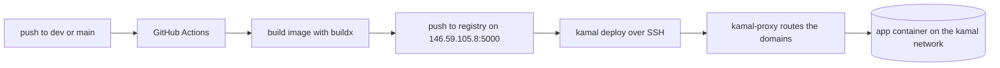

# Deployment

The app is a static page. A push to `dev` or `main` builds the image on a
GitHub runner and deploys it to the deploy host with kamal.

## Environments

| Environment | Branch | Domains | Kamal app | Image |
|---|---|---|---|---|
| dev | `dev` | `dev.memorynote.io` | `memorynote-dev` | `146.59.105.8:5000/memorynote-dev` |
| prod | `main` | `memorynote.io`, `www.memorynote.io` | `memorynote-prod` | `146.59.105.8:5000/memorynote-prod` |

A manual dispatch deploys either environment. A deploy of one environment
never touches the other.

## Pipeline

## Host

The deploy host is `146.59.105.8`. The workflow authenticates as `ubuntu`
with the `SSH_DEPLOY_KEY` secret.

| Component | Details |
|---|---|
| kamal-proxy | One container per host. It routes all app domains and issues Let's Encrypt certificates automatically. All kamal apps on the host share it. |
| Registry | `registry:3` container on port 5000. Unauthenticated: the images hold no credentials. The host runs it with a restart policy, and its docker daemon trusts it via `insecure-registries`. |
| App containers | One per environment, on the shared `kamal` docker network. |

## Behavior

- A newer push to the same branch cancels an in-flight deploy of the
  same environment. Concurrency is keyed per environment, so a manual
  dispatch of the other environment never cancels it.
- A failed deploy leaves the last good version running. Kamal starts
  the new version and registers it with the proxy before it stops the
  old one. If the new version fails, Kamal stops it and the old one
  keeps serving.
- Kamal reuses the running proxy as long as it is at least v0.9.2. An
  older proxy makes the deploy fail visibly. A manual `kamal proxy
  reboot` takes every app on the host down briefly.
- Each deploy prunes the app's old containers and images. It does not
  prune the registry. At this image size the growth is negligible.
- `docs/adr/0002-shared-kamal-proxy-for-all-apps.md` records the proxy
  choice.
- `docs/adr/0001-host-local-image-registry.md` records the registry
  choice.
