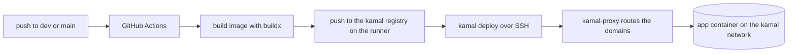

# Deployment

The app is a Next.js static export served by nginx. A push to `dev` or
`main` builds the image on a GitHub runner and deploys it to the deploy
host with kamal.

## Environments

| Environment | Branch | Domains | Kamal app | Image |
|---|---|---|---|---|
| dev | `dev` | `dev.memorynote.io` | `memorynote-dev` | `localhost:5000/memorynote-dev` |
| prod | `main` | `memorynote.io`, `www.memorynote.io` | `memorynote-prod` | `localhost:5000/memorynote-prod` |

A manual dispatch deploys either environment. A deploy of one environment
never touches the other.

## Build

The image is two-stage. `node:22-alpine` runs `npm ci` and `next build`
with `output: "export"`. `nginx:1.27-alpine` serves the export from
`out/` on port 80. The build reads `NEXT_PUBLIC_BUILD_BRANCH` and
`NEXT_PUBLIC_BUILD_COMMIT` and inlines them into the footer.

Kamal reads build args from the config file only. The checked-in kamal
configs carry empty defaults. The deploy workflow stamps the branch and
commit of the pushed ref into the config. The footer of the deployed
site then shows both. A manual deploy without stamping serves the empty
defaults, and the footer shows its first line only.

## Pipeline

The registry runs on the GitHub runner, not on the deploy host. Kamal
starts it as part of every deploy and the deploy host pulls the image
through an SSH port forward to `127.0.0.1:5000`.

## Host

The deploy host is `146.59.105.8`. The workflow authenticates as `ubuntu`
with the `SSH_DEPLOY_KEY` secret.

| Component | Details |
|---|---|
| kamal-proxy | One container per host. It routes all app domains and issues Let's Encrypt certificates automatically. All kamal apps on the host share it. |
| App containers | One per environment, on the shared `kamal` docker network. |

## Behavior

- The proxy serves each domain over HTTPS and redirects HTTP requests to
  HTTPS.
- The app container answers the proxy's health check. The proxy polls
  `GET /up` on the new container and the deploy fails if it does not
  answer 200 within 30 seconds.
- A newer push to the same branch cancels an in-flight deploy of the
  same environment. Concurrency is keyed per environment, so a manual
  dispatch of the other environment never cancels it.
- A failed deploy leaves the last good version running. Kamal starts
  the new version and registers it with the proxy before it stops the
  old one. If the new version fails, Kamal stops it and the old one
  keeps serving.
- Kamal reuses the running proxy as long as it is at least v0.9.2. An
  older proxy makes the deploy fail visibly. A manual `kamal proxy
  reboot` takes every app on the host down briefly.
- Each deploy prunes the app's old containers and images on the host.
  The registry runs on the ephemeral runner, so it keeps no history.
- `docs/adr/0002-shared-kamal-proxy-for-all-apps.md` records the proxy
  choice.
- `docs/adr/0001-kamal-local-image-registry.md` records the registry
  choice.
